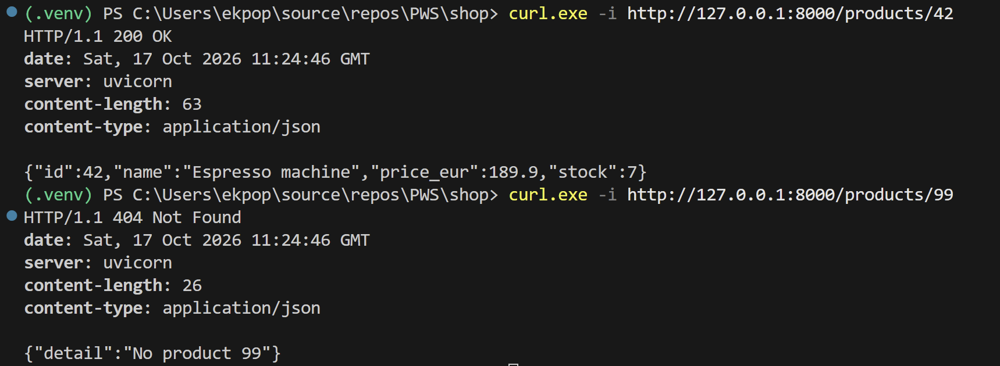
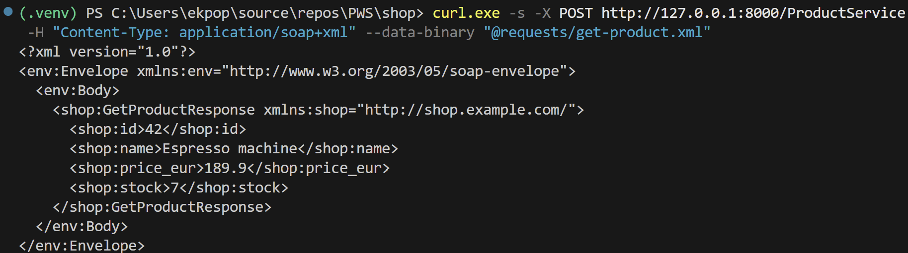
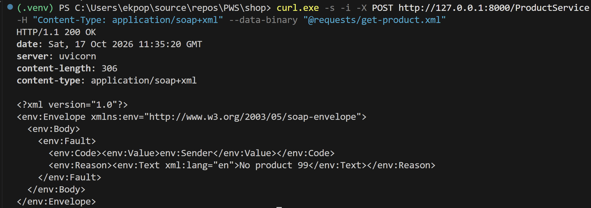
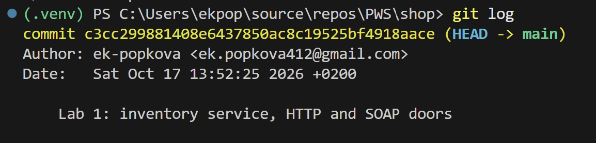
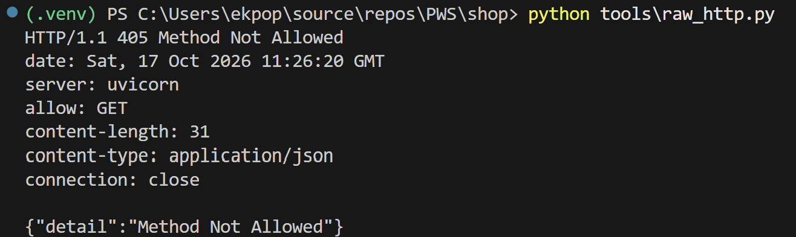

# Shop — Web Services M2 SIA

Lab 1: the Inventory service, behind two doors.

## Run it

    python -m uvicorn services.inventory.main:app --reload --port 8000

## Before you leave the room

`GET /products/42` answers **200**, and `/products/99` answers **404**:

The SOAP call answers with an envelope:

And its fault answers **200 OK**:

`git log` with the commit:

## Questions

1. In section 3, what status line did `DELETE /products/42` return, and what did
   the `allow` header say? Why that answer rather than a 404?

   The status line was `HTTP/1.1 405 Method Not Allowed`, and the header said `allow: GET`.
   It is not a 404 because the resource `/products/42` does exist: what is wrong is the
   method, not the path. The service only routes `GET` on that path, so it answers that
   this verb is not supported here and lists, in `allow`, the methods that are.

   

2. In section 4.5 the SOAP call failed. What did the HTTP status line say? Name one
   piece of infrastructure that is misled by it, and what it does wrong as a result.

   It said `HTTP/1.1 200 OK`, although the body contained an `env:Fault` with
   "No product 99" (see the SOAP fault screenshot above). A monitoring dashboard is misled: it reads only the status codes,
   so it counts this failed call as a success, and an error rate that is rising stays
   invisible. A load balancer is misled in the same way: its health checks see 200 and
   keep sending traffic to an instance that only answers faults.

3. Which of the two doors could a colleague use tomorrow without asking you anything?
   List precisely what they would need in each case.

   The HTTP door. For it, they need only the base URL: the method and the path name
   the operation (`GET /products/{id}`), the status code says whether it worked, and
   `/docs` lists the routes and their parameters, generated from the code.

   For the SOAP door they would need much more, and none of it is published: the URL
   `/ProductService`, the fact that it is always `POST`, the `Content-Type`
   `application/soap+xml`, the envelope structure, the two namespaces (SOAP 1.2 and
   `http://shop.example.com/`), the element names `GetProduct` and `id`, and the shape
   of the answer and of a fault. There is no WSDL, and `/docs` shows the operation with
   no description of its body, so they would have to ask me.
