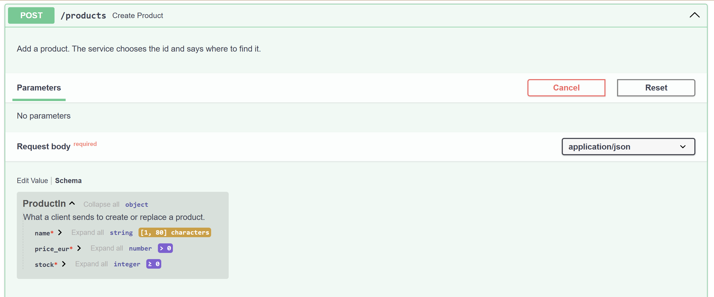
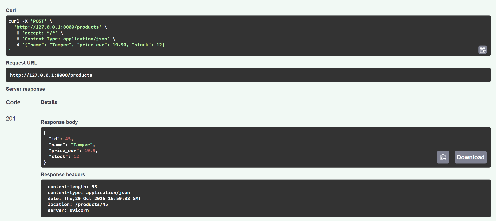
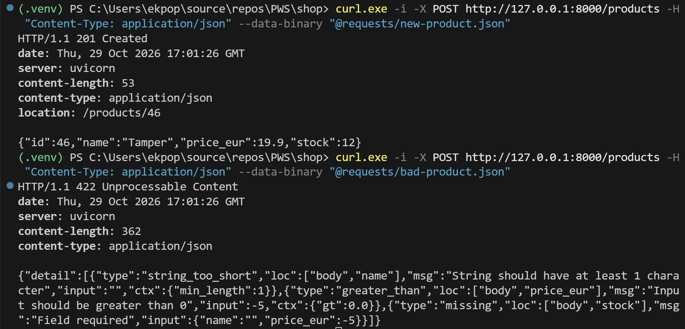
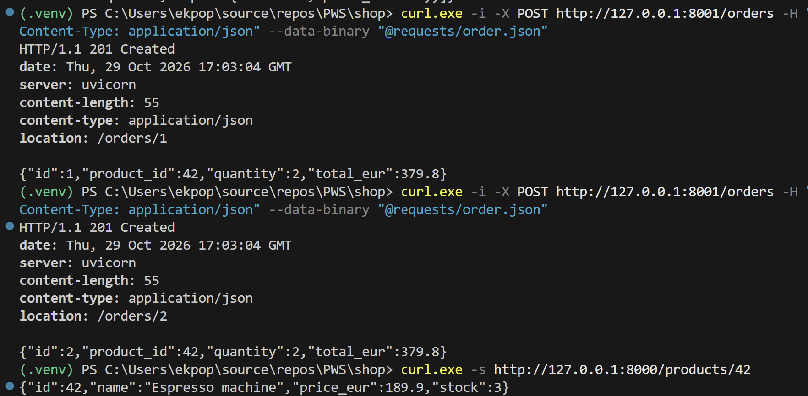
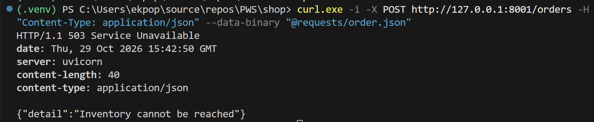
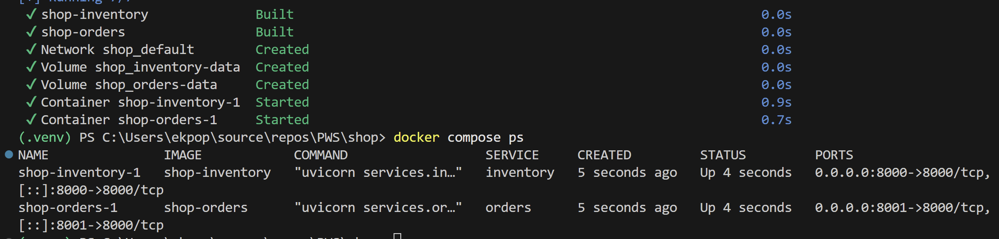

# Shop — Web Services M2 SIA

Lab 2: a REST contract, a SQLite store, a second service, and the whole system in Docker Compose.

## Run it

```text
docker compose up --build -d
```

Inventory: http://127.0.0.1:8000/docs — Orders: http://127.0.0.1:8001/docs

## Before you leave the room

`/docs` of Inventory, with the `ProductIn` schema of `POST /products` visible:



One operation tried from the page: `POST /products` executed with **Try it out**:



`POST /products` answers **201** with a `location` header, and the invalid product answers **422**:



Two identical orders answer **201** (ids 1 and 2), and the stock of product 42 is lower afterwards:



An order answers **503** while Inventory is stopped:



`docker compose ps` with both containers up:



## Lab 2 questions

1. **In section 3.4 you sent the same PUT twice and, in section 4.3, the same order twice. What did each second request change? After a timeout, which one may a client resend without asking, and which one may it not?**

   The second `PUT /products/45` changed nothing: it answered `200` with exactly the same product as the first one, because `PUT` sets the whole resource to the state in the body, and the state was already that. The second `POST /orders` with the same body changed a lot: it created a second order (`location: /orders/2`, after `/orders/1` for the first one) and reserved two more units. Product 42 started with a stock of 7 and each order takes 2 units, so after the two orders the stock is 3, as `GET /products/42` shows on the screenshot of the two orders above.

   After a timeout the client does not know whether its request was applied. It may resend the `PUT` without asking: `PUT` is idempotent, so one or two executions leave the server in the same state. It may not resend the `POST /orders`: `POST` is not idempotent, and if the first one was applied, the retry places a duplicate order and takes stock a second time. Before retrying it should check first, for example with `GET /orders`.

2. **Orders reserves stock with POST /products/{id}/reservations. Why not let Orders read the stock with GET, then write the new value with PATCH? Describe two orders arriving at the same moment for the last unit.**

   Because read-then-write is two separate requests, and another request can run between them. Product 42 has `stock: 1`. Order A sends `GET /products/42` and reads 1; order B sends `GET /products/42` at the same moment and also reads 1. Both conclude that the unit is available. A sends `PATCH {"stock": 0}`, B sends `PATCH {"stock": 0}`. Both answer `200`, both orders are recorded as `201`, and the stock is 0: one unit was sold twice, and B's write silently overwrote A's (a lost update).

   With the reservation, the check and the subtraction are one SQL statement, `UPDATE products SET stock = stock - ? WHERE id = ? AND stock >= ?`, which SQLite runs atomically. The first order to reach it takes the unit and gets `201`; for the second, the condition `stock >= 1` no longer holds, `rowcount` is 0, and it gets `409 Conflict`. Inventory owns its stock, so the rule about it is enforced inside Inventory, not by a client.

3. **When Inventory is stopped, Orders answers 503. What would a client have received without the try/except, and why is that answer wrong?**

   `httpx.get` raises `httpx.ConnectError`; without the `except`, nothing catches it, and FastAPI answers `500 Internal Server Error` with the body `Internal Server Error`.

   That answer is wrong because a `500` means "a bug in this server": it blames Orders, whose code is fine. The real situation is that a dependency is temporarily unavailable, which is exactly what `503 Service Unavailable` says, and it tells the client the request may succeed if retried later. With a `500` the client cannot tell a bug from an outage, so it does not know whether to retry; the body says nothing about Inventory; and monitoring counts a crash of Orders and sends the on-call developer to the wrong service.

4. **In compose.yaml, Orders reaches Inventory at http://inventory:8000. Why not http://127.0.0.1:8000, which worked in section 4?**

   In section 4 both services ran as processes on the same machine, so `127.0.0.1` (the loopback of that machine) reached Inventory on port 8000. In Compose each service runs in its own container, with its own network stack: inside the Orders container, `127.0.0.1` is the Orders container itself, where only Orders listens, so the call would fail and Orders would answer `503`. Compose puts both containers on one network (`shop_default`) and gives each service a DNS name equal to its service name, so `inventory` resolves to the address of the Inventory container (`172.20.0.x`). Port `8000` is the port inside that container; the `8000:8000` mapping in `ports` is only for clients outside Docker.
